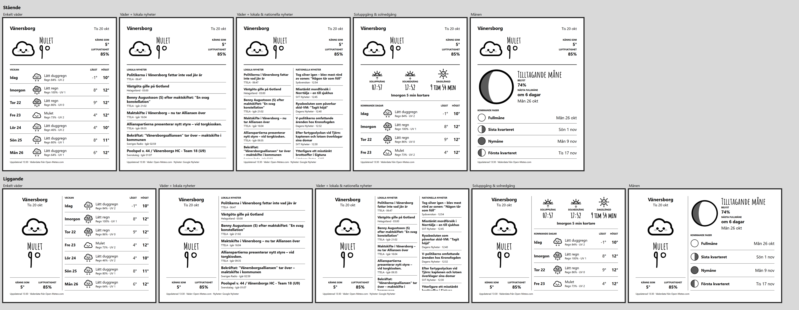

# kindleWeather

A [KOReader](https://koreader.rocks) plugin that turns a jailbroken Kindle's sleep screen into a weather display. It wakes the Kindle on a schedule, fetches a fresh forecast over Wi-Fi and puts it back to sleep.



*Browser mock-up of the five screens. On the Kindle they are drawn by KOReader.*

## Features

- **Five screens**, each in portrait and landscape:
  - **Simple weather**: current conditions and a seven-day list starting today
  - **Weather + local news**: headlines that mention your town (Google News)
  - **Weather + local & national news**: local and national headlines side by side
  - **Sunrise & sunset**: today's sun times and day length, plus the coming days' weather
  - **Moon**: current phase, illumination, next full moon and upcoming phases, calculated on the device
- **Weather data from SMHI** (default, Nordic countries only) or **Open-Meteo** (worldwide). UV index and sun times always come from Open-Meteo.
- **Timed refresh** every 1, 2, 3 or 6 hours while the Kindle sleeps.
- **Refresh before sleep**: a new forecast is fetched when you put the Kindle to sleep, if Wi-Fi is connected and the forecast is more than 10 minutes old.
- **Night mode**: no timed refreshes during the hours you choose (default 23:00–06:00).
- **English and Swedish** text, including SMHI's official weather descriptions.
- Hand-drawn icons and the [Amatic SC](https://fonts.google.com/specimen/Amatic+SC) font.
- Searchable location (any city, via Open-Meteo's geocoding).

## Requirements

- A **jailbroken Kindle** with **KOReader** installed.
- The Kindle must **not show lock-screen ads** (Special Offers). On ad-supported Kindles, KOReader can't draw its own sleep screen.
- **Wi-Fi** switched on in the Kindle's settings. You don't need to be connected when the Kindle goes to sleep; the plugin connects by itself for each refresh.

Tested on a **Kindle Paperwhite 3 (7th gen)**, firmware 5.16.2.1.1, with KOReader v2026.07.1. The timed Wi-Fi handling uses Kindle-specific tools (`wpa_cli`, `udhcpc`, `lipc`), so other Kindle models may behave differently, and non-Kindle devices aren't supported for timed refreshes.

## Installation

1. Copy the `weatherscreen.koplugin` folder to `koreader/plugins/` on the Kindle.
2. Restart KOReader.
3. Open **Tools → Weather screensaver** and choose **Refresh now**.
4. Choose **Preview** to see the screen, or press the power button.

The weather screen is shown whenever the Kindle goes to sleep from inside KOReader.

## Settings

All settings are under **Tools → Weather screensaver**:

| Setting | What it does |
|---|---|
| Show weather when sleeping | Turns the plugin's sleep screen and timed refreshes on or off |
| Screen | Chooses one of the five screens |
| Orientation | Portrait, or landscape with the Kindle logo on the left or right |
| Preview | Shows the current screen and saves `koreader/weatherscreen_preview.png` |
| Save all screens as images | Saves every screen in both orientations to `koreader/weatherscreen_gallery/` |
| Refresh now | Downloads a new forecast immediately |
| Location | Searches for a city by name |
| Weather data | SMHI or Open-Meteo |
| Refresh | Every 1, 2, 3 or 6 hours (default 3) |
| Night mode | Pauses timed refreshes between two hours you choose |
| Language | English or Svenska |

## Battery

Each timed refresh keeps Wi-Fi on for only a few seconds, but the Kindle stays awake for about a minute: its power daemon waits 60 seconds in screensaver mode before deep sleep, and that can't be changed without modifying the system. Fewer wakes is what saves battery:

- Use a **3-hour interval** rather than 1 hour.
- Turn on **night mode**.

Every refresh logs the battery level and duration to `koreader/crash.log` (lines starting with `WeatherScreen: refresh`), so you can measure the real drain.

## How timed refresh works on a Kindle

- KOReader's wakeup manager sets an RTC alarm through the Kindle's power daemon (`powerd`).
- After the alarm the Kindle stays in screensaver mode, where Amazon's Wi-Fi daemon won't reconnect. The plugin brings the interface up itself (`ifconfig wlan0 up`, `wpa_cli reconnect`), requests an address with `udhcpc`, and adds the default route that the system skips in this mode.
- It downloads the forecast, redraws the sleep screen and schedules the next wake. Wakes that would fall in night mode are moved to the end of the night.

## Data sources and credits

- Weather: [SMHI Open Data](https://opendata.smhi.se) and [Open-Meteo](https://open-meteo.com). The sleep screen shows the source.
- News: Google News RSS (Swedish edition).
- Moon phases: calculated with Jean Meeus' method from *Astronomical Algorithms*.
- Font: Amatic SC, © The Amatic SC Project Authors, under the SIL Open Font License (`weatherscreen.koplugin/fonts/OFL-AmaticSC.txt`).
- Icons: drawn by `tools/make_icons.py`.

## Development

The project's checks run the specs on LuaJIT (the same engine as KOReader), lint with luacheck, and check the coding rules (no comments, at most two parameters and 50 lines per function, at most 250 lines per file):

```sh
pip install lupa
# download the luacheck v1.2.0 source and point LUACHECK_SRC at its src folder
LUACHECK_SRC=/path/to/luacheck/src python tests/run_checks.py
```

Regenerate the icons after changing `tools/make_icons.py`:

```sh
python tools/make_icons.py
```

The specs cover the parts that don't need KOReader: forecast parsing (SMHI and Open-Meteo), formatting, translations, scheduling, news feeds and moon phases. The drawing and Wi-Fi code can only be tested on a Kindle.
